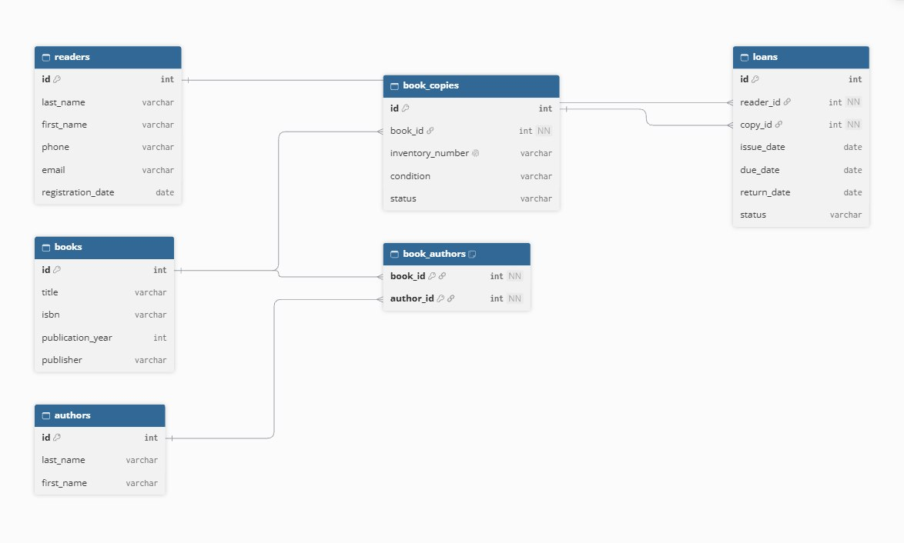

# Лабораторная работа №3
## Анализ и моделирование данных предметной области

**Вариант 5 — Библиотечная система**

## 1. Описание предметной области

**Предметная область:** библиотечная система.

Библиотечная система предназначена для учета библиотечного фонда, регистрации читателей, выдачи и возврата книг, а также контроля доступности экземпляров.

### Основные процессы

- Ведение каталога книг.
- Регистрация читателей библиотеки.
- Учет авторов и произведений.
- Учет экземпляров книг.
- Выдача книг читателям.
- Регистрация возврата книг.
- Контроль сроков возврата и доступности экземпляров.
- Хранение истории выдачи и возврата книг.

### Пользователи системы

- Библиотекари.
- Читатели библиотеки.
- Администраторы системы.

### Основные задачи информационной системы

- Хранение информации о книгах и авторах.
- Хранение информации о читателях.
- Учет экземпляров библиотечного фонда.
- Регистрация выдачи и возврата книг.
- Контроль сроков возврата.
- Определение доступных экземпляров.
- Просмотр истории выдачи книг читателям.

## 2. Объекты данных

В предметной области выделены следующие основные объекты данных.

### Читатель (`readers`)

Читатель библиотеки, который может получать книги во временное пользование.

Необходимо хранить:
- идентификатор читателя;
- фамилию и имя;
- номер телефона;
- адрес электронной почты;
- дату регистрации.

### Книга (`books`)

Произведение, включенное в библиотечный каталог.

Необходимо хранить:
- идентификатор книги;
- название;
- ISBN;
- год издания;
- издательство.

### Автор (`authors`)

Человек, создавший литературное произведение.

Необходимо хранить:
- идентификатор автора;
- фамилию;
- имя.

### Экземпляр книги (`book_copies`)

Конкретный физический экземпляр книги, находящийся в библиотечном фонде. Одна книга может иметь несколько экземпляров.

Необходимо хранить:
- идентификатор экземпляра;
- идентификатор книги;
- инвентарный номер;
- физическое состояние;
- статус доступности.

### Выдача книги (`loans`)

Запись о выдаче конкретного экземпляра книги читателю и его последующем возврате.

Необходимо хранить:
- идентификатор выдачи;
- идентификатор читателя;
- идентификатор экземпляра книги;
- дату выдачи;
- планируемую дату возврата;
- фактическую дату возврата;
- статус выдачи.

### Связь книги с автором (`book_authors`)

Промежуточный объект, связывающий книги и авторов. Он необходим, поскольку у одной книги может быть несколько авторов, а один автор может написать несколько книг.

Необходимо хранить:
- идентификатор книги;
- идентификатор автора.

## 3. Атрибуты объектов

Для каждого объекта определены основные атрибуты, их предполагаемые типы данных и назначение.

### Читатель

| Атрибут | Тип данных | Описание |
|---|---|---|
| `id` | Число | Уникальный идентификатор читателя |
| `last_name` | Строка | Фамилия читателя |
| `first_name` | Строка | Имя читателя |
| `phone` | Строка | Номер телефона |
| `email` | Строка | Адрес электронной почты |
| `registration_date` | Дата | Дата регистрации в библиотеке |

### Книга

| Атрибут | Тип данных | Описание |
|---|---|---|
| `id` | Число | Уникальный идентификатор книги |
| `title` | Строка | Название книги |
| `isbn` | Строка | Международный номер книги |
| `publication_year` | Число | Год издания |
| `publisher` | Строка | Название издательства |

### Автор

| Атрибут | Тип данных | Описание |
|---|---|---|
| `id` | Число | Уникальный идентификатор автора |
| `last_name` | Строка | Фамилия автора |
| `first_name` | Строка | Имя автора |

### Экземпляр книги

| Атрибут | Тип данных | Описание |
|---|---|---|
| `id` | Число | Уникальный идентификатор экземпляра |
| `book_id` | Число | Идентификатор книги |
| `inventory_number` | Строка | Инвентарный номер экземпляра |
| `condition` | Строка | Физическое состояние экземпляра |
| `status` | Строка | Статус доступности экземпляра |

### Выдача книги

| Атрибут | Тип данных | Описание |
|---|---|---|
| `id` | Число | Уникальный идентификатор выдачи |
| `reader_id` | Число | Идентификатор читателя |
| `copy_id` | Число | Идентификатор экземпляра книги |
| `issue_date` | Дата | Дата выдачи книги |
| `due_date` | Дата | Планируемая дата возврата |
| `return_date` | Дата | Фактическая дата возврата; может быть пустой до возврата |
| `status` | Строка | Текущий статус выдачи |

### Связь книги с автором

| Атрибут | Тип данных | Описание |
|---|---|---|
| `book_id` | Число | Идентификатор книги |
| `author_id` | Число | Идентификатор автора |

## 4. Классификация данных

Выделенные данные классифицируются по характеру хранимой информации.

| Категория данных | Примеры | Назначение |
|---|---|---|
| Текстовые | Название книги, фамилия и имя читателя, фамилия автора, издательство, ISBN, инвентарный номер | Хранение текстовой информации об объектах |
| Числовые | Идентификаторы объектов, год издания | Хранение числовых значений |
| Даты и время | Дата регистрации, дата выдачи, планируемая и фактическая даты возврата | Хранение информации о событиях |
| Логические | Признак доступности экземпляра, если он представлен отдельным значением «да/нет» | Определение возможности выдачи книги |
| Справочные | Статус экземпляра, состояние книги, статус выдачи | Хранение значений из заранее определенного набора |
| Вычисляемые | Количество доступных экземпляров, количество книг на руках у читателя | Получение значений на основе других данных |

Количество доступных экземпляров можно определить по числу экземпляров, которые доступны для выдачи и не находятся на руках у читателей. Просрочку возврата можно определить сравнением планируемой даты возврата с текущей датой при условии, что книга еще не возвращена.

## 5. Связи между объектами

### Читатель — Выдача книги

**Тип связи:** один ко многим (1:N).

Один читатель может получать книги много раз. Каждая запись о выдаче относится к одному конкретному читателю.

### Книга — Экземпляр книги

**Тип связи:** один ко многим (1:N).

Одна книга может иметь несколько физических экземпляров. Каждый экземпляр относится к одной записи каталога.

### Экземпляр книги — Выдача книги

**Тип связи:** один ко многим (1:N).

Один экземпляр книги может участвовать в нескольких выдачах в разные периоды времени. Каждая запись о выдаче относится к одному конкретному экземпляру. При этом один экземпляр не должен одновременно выдаваться нескольким читателям.

### Книга — Автор

**Тип связи:** многие ко многим (M:N).

Одна книга может быть написана несколькими авторами, а один автор может написать несколько книг. Для реализации этой связи используется промежуточная сущность `book_authors`, содержащая идентификаторы книги и автора.

## 6. Концептуальная модель данных

В модели представлены основные объекты библиотечной системы, их атрибуты и взаимосвязи.

Связи модели:
- `readers` 1:N `loans`;
- `books` 1:N `book_copies`;
- `book_copies` 1:N `loans`;
- `books` 1:N `book_authors`;
- `authors` 1:N `book_authors`.

Последние две связи вместе образуют связь «Книга — Автор» M:N через промежуточную сущность `book_authors`.

Книга и экземпляр книги представлены отдельно. Это позволяет учитывать несколько физических экземпляров одного произведения и контролировать доступность каждого экземпляра.

### Код диаграммы для dbdiagram.io

## 7. Оценка качества исходных данных

### 1. Достаточно ли объектов выделено?

Да. Выделенные объекты позволяют описать основные процессы библиотечной системы: учет читателей, ведение каталога, учет экземпляров и регистрацию выдачи и возврата книг.

### 2. Отсутствуют ли важные сущности?

Для базовой модели основных сущностей достаточно. При дальнейшем развитии системы можно добавить библиотекарей, жанры, бронирование книг, штрафы за просрочку и историю изменения состояния экземпляров.

### 3. Все ли необходимые атрибуты определены?

Для концептуальной модели определены основные атрибуты каждого объекта. При практической реализации можно добавить язык издания, количество страниц, описание книги и дополнительные сведения об авторах.

### 4. Имеются ли дублирующиеся данные?

Явного дублирования данных в модели нет. Информация о читателях, книгах, авторах, экземплярах и выдачах хранится в отдельных объектах. Связи между ними устанавливаются с помощью идентификаторов.

### 5. Достаточно ли информации для дальнейшего проектирования информационной системы?

Да. Определены основные объекты, их атрибуты и связи. Полученная модель может использоваться как основа для дальнейшего проектирования базы данных библиотечной системы.

### Вывод

В ходе лабораторной работы была проанализирована предметная область библиотечной системы. Были выделены основные объекты данных, определены их атрибуты и выполнена классификация данных.

Между объектами были установлены связи один ко многим и многие ко многим. Для связи книг и авторов предусмотрена промежуточная сущность. Также была определена структура учета экземпляров, выдачи и возврата книг.

В результате была подготовлена концептуальная модель данных, отражающая основные процессы библиотечной системы и пригодная для дальнейшего проектирования базы данных.
